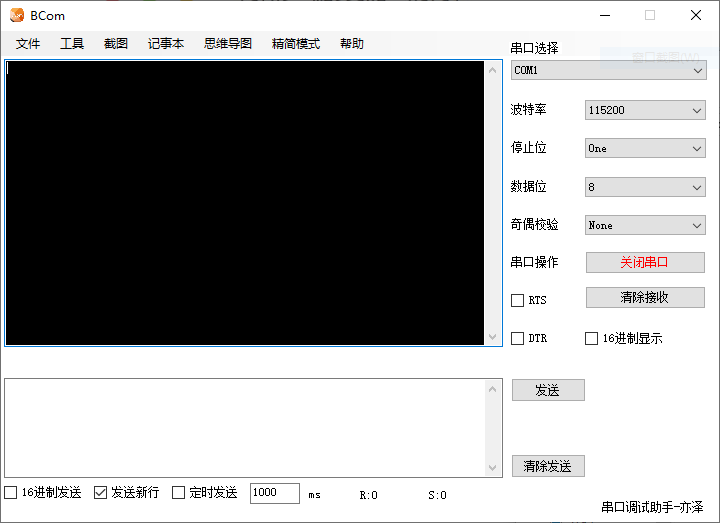
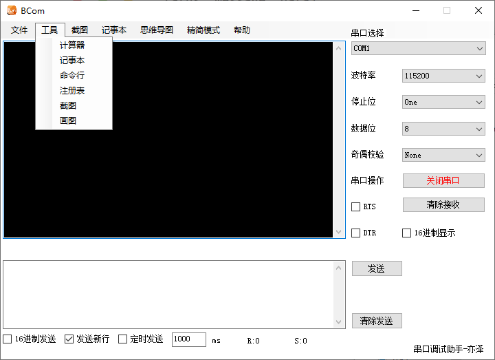

# BCom
开源的多功能串口调试助手
注意：部分工具由于X64和X86系统的原因不能使用（例如截图工具），所以，要想解决这个问题，需要在Properties里面把首选32位平台去掉


主界面



工具栏



## Windows 自动打包

项目基于 **.NET Framework 4.7.2 / Windows Forms**，使用 GitHub Actions 在 Windows 上编译 Release 版本，并生成可直接解压使用的 ZIP（不是安装程序）。

- 向 `master` 推送提交或提交目标为 `master` 的 Pull Request 后自动构建；也可以在 **Actions → Build and package BCom → Run workflow** 手动触发。
- 构建成功后，在对应的 Actions 运行记录底部 **Artifacts** 中下载 `bcom-windows`；其中包含 `BCom-*-windows.zip`。
- 推送以 `v` 开头的标签（如 `v2.0.1`）时，将自动生成或更新同名 GitHub Release，并附上 Windows ZIP 安装包。
- 下载后解压 ZIP，在已安装 **.NET Framework 4.7.2 或更高兼容版本（4.x）** 的 Windows 系统上运行 `BCom.exe`。请保留压缩包中其他文件与其同目录。

打标签示例：

```bash
git tag v2.0.1
git push origin v2.0.1
```
